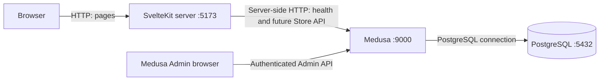

# OLOYE architecture

OLOYE is a pnpm monorepo containing two independently runnable applications. The root owns developer tooling and documentation; each app owns its package manifest, runtime configuration and build.

## Structure

```text
oloye/
├── apps/
│   ├── storefront/
│   │   ├── src/
│   │   │   ├── lib/
│   │   │   │   ├── components/        Reusable Svelte components
│   │   │   │   ├── config/            Safe application metadata
│   │   │   │   └── server/            Private Medusa HTTP utilities
│   │   │   ├── routes/                Pages, layouts, error boundary and readiness
│   │   │   ├── env.ts                 Explicit private environment schema
│   │   │   ├── hooks.server.ts        Sanitised unexpected-error handling
│   │   │   ├── app.css                Tailwind v4 entry point
│   │   │   ├── app.html               HTML document
│   │   │   └── error.html             Fatal-error fallback
│   │   ├── static/                    Public static assets
│   │   ├── .env.example
│   │   ├── package.json
│   │   ├── tsconfig.json
│   │   └── vite.config.ts             SvelteKit 3 and Node adapter configuration
│   └── commerce/
│       ├── src/                      Future Medusa extension points
│       ├── static/                   Local Medusa file-provider storage (ignored)
│       ├── .env.example
│       ├── medusa-config.ts          Database, CORS and session/auth configuration
│       ├── package.json
│       └── tsconfig.json
├── infra/
│   ├── .env.example                  PostgreSQL credential template
│   ├── compose.yaml                  PostgreSQL and persistent volume
│   └── compose.mjs                   Docker invocation, with optional Windows WSL support
├── package.json
├── pnpm-workspace.yaml
├── pnpm-lock.yaml
├── .npmrc                            Medusa-required dependency hoisting
├── .gitignore
├── .node-version / .nvmrc
├── README.md
├── ARCHITECTURE.md
└── VERIFICATION.md
```

There are no shared packages or cross-app source imports. pnpm's dependency storage and Medusa-required hoisting are installation details, not application coupling.

## Responsibilities and communication



| Component | Owns | Communicates with |
| --- | --- | --- |
| Storefront | Customer presentation, page loading, browser interactions and server-side commerce integration | Medusa over HTTP |
| Medusa | Products, pricing, inventory, customers, carts, orders, payments, auth, sales channels, workflows and administration | PostgreSQL and future configured providers |
| PostgreSQL | Persistent commerce data and standard Medusa migrations | Medusa |
| Infrastructure | Local database lifecycle and persistent storage | Docker |

The browser never connects to PostgreSQL. The storefront has no database dependency and receives no commerce admin credentials. Medusa is the source of truth for commerce data.

## Storefront foundation

SvelteKit 3 config lives in `vite.config.ts`; the `#lib` package import maps to `src/lib`. Svelte 5 components use TypeScript and runes. Tailwind 4 is integrated through `@tailwindcss/vite`; the visual identity tokens live in `src/app.css`.

The server-only Medusa transport powers storefront `/health`, which returns HTTP 503 for backend outages. The homepage renders its own presentation content and makes no commerce requests. Backend availability therefore does not delay homepage rendering.

`src/env.ts` validates the backend origin and timeout and declares the publishable key as private. SvelteKit prevents browser imports of `$app/env/private` and files under `lib/server`. Dynamic runtime configuration allows the same built storefront to target different Medusa deployments.

The transport:

- Restricts requests to the configured backend origin and health/Store API paths.
- Adds a publishable key only for Store API requests; health requires none.
- Supports caller-provided request options and request-scoped SvelteKit fetch.
- Enforces a timeout, disables caching and disallows redirects.
- Reports safe errors without forwarding upstream response bodies or secrets.

Transport callers must parse and validate response bodies appropriate to their endpoint. It does not implement commerce logic or expose a general-purpose proxy route.

Navigation has an accessible loading indicator. The root error boundary handles missing pages and request errors; a static fallback handles failures beyond the Svelte component boundary. Unexpected server errors are sanitised.

## Commerce foundation

The Medusa configuration uses `loadEnv` and `defineConfig`, following the official v2 starter. The framework registers its standard commerce modules, built-in APIs and supported local infrastructure providers. There is no custom catalogue implementation, seed data, fake checkout or custom authentication layer.

Authentication uses Medusa's standard auth capabilities. JWT and cookie signing secrets are independent, required and validated. CORS uses explicitly configured origins for Store, Admin and Auth APIs. Session cookies are HTTP-only, SameSite Lax and secure in production.

The selected local configuration runs in one process and uses Medusa's local event bus, in-memory workflow engine, cache, locking and session defaults. PostgreSQL persists commerce data. Redis is omitted because this configuration does not require it. In-memory infrastructure and sessions are unsuitable for multiple backend instances and do not survive process restarts; configure supported persistent providers before production scaling.

Medusa's built-in health route verifies server liveness. Successful migrations and a database query separately establish PostgreSQL connectivity. The standard Medusa Admin is served at `/app`, with no custom admin UI.

The backend owns schema changes through `medusa db:migrate`. The storefront does not run database migrations.

## Deployment boundaries

The storefront's Node adapter emits its own server artifact. Medusa emits its own server artifact and bundled admin. Each can have separate hosts, release schedules, environment variables and infrastructure, while retaining the HTTP integration boundary.

Application builds do not require the other app to be running. Startup and commerce operations require PostgreSQL; the storefront can run while commerce is offline. Full deployment details and production providers are intentionally left to their milestone.

Local secrets and generated build/runtime files are ignored by Git. Production must supply credentials via the deployment platform, preserve database certificate validation, serve HTTPS and configure actual origins.

## Future extension points

| Future requirement | Intended location/boundary |
| --- | --- |
| Product catalogues and collection pages | SvelteKit routes and components; data from Medusa Store API |
| 3D garments/assets | Storefront components and public assets or object storage; Three.js and Threlte added when needed |
| Motion | Storefront components; GSAP added at the animation milestone |
| Payments | Medusa's supported payment providers and workflows; private provider credentials in commerce |
| Customer accounts | Medusa customer/auth capabilities with SvelteKit server handling |
| Administration | Standard Medusa Admin; documented `src/admin` extensions only when needed |
| External integrations | Medusa providers, subscribers, workflows and jobs |
| Persistent sessions/distributed execution | Medusa's supported shared infrastructure providers |

These are architectural extension points; live catalogue, shopping and 3D functionality are not implemented here.

## Homepage presentation

`routes/+page.svelte` composes seven focused homepage section components from `lib/components/home`. `lib/components/layout` owns the shared header, footer and modal interfaces. `lib/components/ui` contains icons, responsive images, text links and product cards.

`lib/content/home.ts` contains homepage copy, collections, navigation and footwear views, and imports its four featured products from the shared typed frontend catalogue. These are illustrative frontend records. `lib/content/photography.json` centralises local asset keys, dimensions, attribution and original sources. Images and licensed font subsets are public static assets; no private configuration is imported by presentation components.

`lib/state/presentation.svelte.ts` creates an instance per root layout using Svelte context. Wishlist selections persist in local storage on the current device, synchronise between tabs and fall back to per-visit state if storage is unavailable. Modal and wishlist state are not shared between server requests or sent to Medusa. Newsletter validation is local and explicitly reports that an address has not been subscribed or saved.

`/collections/[collection]` and `/search` share reusable listing, filter and search components backed by the typed modules in `lib/catalogue`. Search, filters and sorting use URL query parameters and operate independently of commerce. `/products/[slug]` provides a lightweight first look; full product details remain a later milestone. Legacy collection and product preview links redirect to these routes, while editorial previews remain available. `/information/[slug]` provides launch information and credits without fabricating store policies, support inboxes or social profiles. Unknown destinations use the existing 404 boundary.

Native dialogs provide modal/inert behaviour, Escape dismissal and focus restoration; explicit Tab wrapping keeps focus within the active dialog. Desktop category dropdowns use buttons with expanded state and normal keyboard-accessible links. CSS respects reduced motion. See [HOMEPAGE.md](HOMEPAGE.md), [CATALOGUE.md](CATALOGUE.md) and [PHOTOGRAPHY.md](PHOTOGRAPHY.md).
